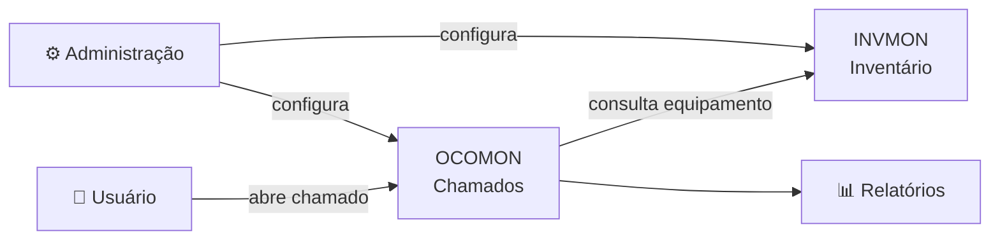

# 🎧 Bem-vindo ao material OcoMon

> [!abstract] O que é o OcoMon?
> O **OcoMon** é um sistema web de **Helpdesk / Service Desk** de código aberto, voltado ao **gerenciamento completo de chamados de suporte** e ao **controle integrado de inventário** de equipamentos de informática.

Este material é o ponto de partida para quem quer **conhecer, instalar, configurar e usar** o OcoMon no dia a dia da TI.

---

## 🧭 Mapa deste material

| #   | Nota                               | O que você vai ver                             |     |
| --- | ---------------------------------- | ---------------------------------------------- | --- |
| 1   | [[01 - O que é o OcoMon]]          | Conceito, história e para quem serve           |     |
| 2   | [[02 - Módulos]]                   | Chamados, inventário e administração           |     |
| 3   | [[03 - Docker]]                | Requisitos, banco de dados e Docker            |     |
| 4   | [[04 - Primeiros passos]]          | Login, áreas, usuários e configurações básicas |     |
| 5   | [[05 - Fluxo de um chamado]]       | Do pedido do usuário ao encerramento           |     |
| 6   | [[06 - Boas práticas e segurança]] | Atualização, senhas e cuidados                 |     |
| 7   | [[07 - Links e referências]]       | Site oficial, downloads e comunidade           |     |

> [!tip] Dica de uso no Obsidian
> Crie as notas acima com os nomes exatos dos links. Clique em um `[[link]]` vazio e o Obsidian cria a nota para você. Use o **Graph View** para enxergar o mapa do material.

---

## 📖 Um pouco de história

- Nasceu em **março de 2002**, como projeto pessoal do programador **Franque Custódio**, inicialmente para cadastro, acompanhamento, controle e consulta de ocorrências de suporte.
- O primeiro usuário foi o **Centro Universitário La Salle (UNILASALLE)**.
- Depois, o analista de suporte **Flávio Ribeiro** assumiu o projeto e o evoluiu, adicionando recursos pensados para a rotina operacional e gerencial de Helpdesks e Service Desks.
- Hoje é distribuído sob licença **GPL**, e já foi usado em estudos acadêmicos sobre gestão de TI com **ITIL**.
   ![[Pasted image 20261104103815.png|685]]
	Franque Custório & Flávio Ribeiro
## ✨ Por que usar o OcoMon?

- 💸 **Software livre**: sem custo de licença.
- 🧩 **Customizável**: por ser código aberto, dá para adaptar telas, relatórios e regras ao seu negócio.
- 🛠️ **Simples de implantar**: roda em stack comum (Apache + PHP + MySQL).
- 📦 **Tudo em um só lugar**: chamados **e** inventário integrados.
- 🇧🇷 **Comunidade brasileira**: documentação e vídeos em português.

---

## 🧱 Visão geral dos módulos

- **OCOMON** → abertura, atendimento, acompanhamento e encerramento de chamados.
- **INVMON** → cadastro e controle de equipamentos, componentes, softwares, garantias e fornecedores.
- **Administração** → áreas, usuários, status, prioridades, categorias de problemas, SLAs, e-mails, entre outros.

Detalhes em [[02 - Módulos]].

---

## ⚙️ Stack técnica (resumo)

| Item | Tecnologia |
|------|------------|
| Linguagem | PHP |
| Banco de dados | MySQL |
| Servidor web | Apache (recomendado) |
| Front-end | HTML, CSS, JavaScript |
| Licença | GPL |
| Teste rápido | Imagem Docker de demonstração |

> [!warning] Versões
> Os requisitos mudam entre versões (a série 2.x pedia PHP 4.3+ e MySQL 4.1+; as séries 3.x e 4.x são bem mais modernas). Confira sempre o `README` da versão que você vai instalar, no site oficial.

---

## 🚀 Quer testar agora?

A forma mais rápida de ver o sistema funcionando é pelo **Docker**, usando a imagem de demonstração mantida pelo autor. Veja o passo a passo em [[03 - Docker]].

---

## ✅ Checklist de início

- [ ] Ler [[01 - O que é o OcoMon]]
- [ ] Entender os [[02 - Módulos]]
- [ ] Subir um ambiente de teste ([[03 - Docker]])
- [ ] Configurar áreas, usuários e prioridades ([[04 - Primeiros passos]])
- [ ] Abrir e encerrar um chamado de teste ([[05 - Fluxo de um chamado]])
- [ ] Revisar segurança antes de colocar em produção ([[06 - Boas práticas e segurança]])

---

> [!quote] Bom estudo!
> Use esta nota como **home** do vault: fixe a aba (*Pin*) e volte aqui sempre que precisar se localizar. 🎯

**Próxima nota:** [[01 - O que é o OcoMon]] →