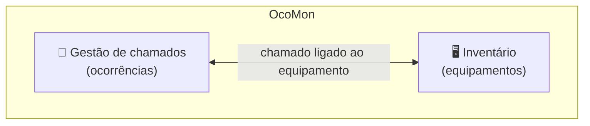

# 🧠 O que é o OcoMon

← Voltar: [[ocomon-bem-vindo|Início]] | Próxima: [[02 - Módulos]] →

> [!abstract] Em uma frase
> O OcoMon é um **sistema web de Helpdesk/Service Desk de código aberto** que organiza os **chamados de suporte** de uma empresa e, no mesmo lugar, controla o **inventário de equipamentos de informática**.

---

## 1. O problema que ele resolve

Sem uma ferramenta, o suporte de TI costuma funcionar assim:

- pedidos chegam por telefone, WhatsApp, e-mail e corredor;
- ninguém sabe quantos chamados estão abertos, nem há quanto tempo;
- não há histórico: o mesmo problema volta e ninguém lembra a solução;
- não se sabe qual equipamento está com quem, nem a garantia dele.

O OcoMon centraliza tudo isso: **cada pedido vira um chamado registrado**, com responsável, status, prioridade e histórico.

---

## 2. O nome

**OcoMon** vem de **Oco**rrências + **Mon**itoramento: um sistema para **cadastrar, acompanhar, controlar e consultar ocorrências** de suporte.

---

## 3. As duas metades do sistema

### 🎫 Gestão de chamados
Registro e acompanhamento de solicitações e incidentes de suporte, do pedido até o encerramento.

### 🖥️ Controle de inventário
Cadastro dos equipamentos de informática, com fabricante, modelo, fornecedor, garantia, softwares e licenças.

> [!tip] Por que a integração importa
> Ao abrir um chamado sobre um computador, você enxerga o histórico **daquele equipamento**. Isso ajuda a decidir entre consertar e trocar.

---

## 4. O que dá para configurar

Pelo menu de administração, o sistema permite cadastrar e ajustar, entre outros:

| Grupo | Exemplos |
|-------|----------|
| **Atendimento** | status, prioridades, categorias de problemas, níveis de resposta (SLA), tags |
| **Estrutura** | departamentos, unidades, prédios, centros de custo, feriados |
| **Comunicação** | modelos de e-mail, listas de distribuição, mensagens |
| **Inventário** | tipos de equipamento, modelos, fabricantes, fornecedores, prazos de garantia, softwares e tipos de licença |
| **Controle** | perfis de tela, documentos, empréstimos de equipamentos |

> [!note] Observação
> Os nomes e a disponibilidade exatos variam por versão. Confira no menu da versão que você instalou.

---

## 5. Quem usa e para quê

- 👤 **Usuário final**: abre o chamado e acompanha o andamento.
- 🛠️ **Técnico / analista**: atende, registra o que fez e encerra.
- 📋 **Gestor de TI**: consulta relatórios e mede o desempenho do atendimento.
- ⚙️ **Administrador**: configura o sistema e os cadastros.

---

## 6. Características de projeto

- **Software livre**, licença **GPL**: sem custo de licença e com código aberto para adaptar.
- **Stack comum**: PHP + MySQL, em geral sobre Apache.
- **Roda em qualquer sistema operacional** que suporte essa stack.
- **Documentação em português**, com site oficial, vídeos e comunidade.
- **Imagem Docker de demonstração** para testar sem instalar.

---

## 7. Origem e evolução

- Criado em **2002** por Franque Custódio.
- Mantido e evoluído por **Flávio Ribeiro**.
- Passou por várias séries (2.x, 3.x, 4.x) com mudanças grandes de interface e recursos.

---

## 8. Alinhamento com ITIL

Estudos acadêmicos usaram o OcoMon como ferramenta de baixo custo para aplicar práticas do **ITIL**, em especial o **gerenciamento de incidentes** e o suporte ao serviço.

---

## ✅ Para fixar

- [ ] O OcoMon une **chamados** e **inventário**.
- [ ] É **gratuito**, **GPL**, feito em **PHP/MySQL**.
- [ ] Serve para dar **histórico, controle e métricas** ao suporte de TI.

**Próxima nota:** [[02 - Módulos]] →