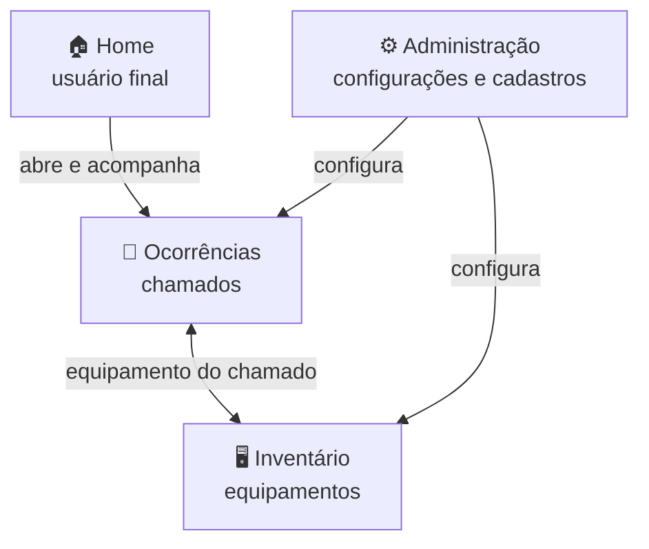

# 🧩 Módulos do OcoMon

← Anterior: [[01 - O que é o OcoMon]] | Início: [[ocomon-bem-vindo|Início]] | Próxima: [[03 - Docker]] →

> [!abstract] Visão geral
> O OcoMon é dividido em **quatro áreas**: a **Home** (usada pelo usuário final) e três módulos de trabalho: **Ocorrências**, **Inventário** e **Administração**.

| Módulo | Quem usa | Para que serve |
|--------|----------|----------------|
| 🏠 [[#Home]] | Usuário final | Abrir e acompanhar os próprios chamados |
| 🎫 [[#Módulo de Ocorrências]] | Técnicos e gestores | Atender, consultar e medir os chamados |
| 🖥️ [[#Módulo de Inventário]] | Técnicos e gestores | Controlar equipamentos e componentes |
| ⚙️ [[#Módulo de Administração]] | Administradores | Configurar o sistema e seus cadastros |

> [!tip] Manual oficial
> Cada item abaixo tem uma página no manual em [Manual - OcoMon](https://ocomon.com.br/site/manual/). Os links estão nas tabelas.

---

## 🏠 Home

A porta de entrada do **usuário final**. Ele não precisa conhecer o resto do sistema.

| Item | O que faz |
|------|-----------|
| [Início](https://ocomon.com.br/site/manual-home-inicio) | Tela inicial |
| [Abrir chamados](https://ocomon.com.br/site/manual-home-abrir-chamado) | Registro de um novo pedido de suporte |
| [Meus chamados](https://ocomon.com.br/site/manual-home-meus-chamados) | Acompanhamento dos chamados do próprio usuário |
| [Esquema de cores](https://ocomon.com.br/site/manual-home-cores) | Personalização visual |
| [Senha](https://ocomon.com.br/site/manual-home-senha) | Troca de senha |
| [Idioma](https://ocomon.com.br/site/manual-home-idioma) | Escolha do idioma da interface |

---

## 🎫 Módulo de Ocorrências

O **coração do atendimento**: é onde os chamados são tratados do começo ao fim.

| Item | O que faz |
|------|-----------|
| [Início](https://ocomon.com.br/site/manual-oco-main-screen) | Tela principal, com a visão geral dos chamados |
| [Abrir chamado](https://ocomon.com.br/site/manual-abertura-chamados) | Abertura de chamados pela equipe de suporte |
| [Detalhamento dos chamados](https://ocomon.com.br/site/manual-oco-detalhes) | Tela completa de um chamado e seu histórico |
| [Encerramento de chamados](https://ocomon.com.br/site/manual-encerramento) | Fechamento com o registro da solução |
| [Consultar](https://ocomon.com.br/site/manual-consultar) | Consulta com filtros |
| [Busca rápida](https://ocomon.com.br/site/manual-busca-rapida) | Localização imediata de um chamado |
| [Soluções](https://ocomon.com.br/site/manual-oco-solucoes) | Base de soluções já registradas |
| [Empréstimos](https://ocomon.com.br/site/manual-emprestimos) | Controle de equipamentos emprestados |
| [Mural](https://ocomon.com.br/site/manual-mural) | Avisos e comunicados |
| [Relatórios](https://ocomon.com.br/site/manual-relatorios) | Estatísticas e relatórios de atendimento |

> [!example] Fluxo típico
> Usuário abre o chamado na **Home** → técnico vê na **tela principal** → atende na tela de **detalhamento** → registra a solução no **encerramento**. Veja em [[05 - Fluxo de um chamado]].

---

## 🖥️ Módulo de Inventário

Controle dos **equipamentos de informática** e de seus componentes.

### Cadastrar

| Item | O que faz |
|------|-----------|
| [Equipamento](https://ocomon.com.br/site/manual-cadastro-equipamento) | Cadastro de um novo equipamento |
| [Documento](https://ocomon.com.br/site/manual-cadastro-documento) | Cadastro de documentos |
| [Componente avulso](https://ocomon.com.br/site/manual-cadastro-componente-avulso) | Peças fora de um equipamento |

### Visualizar

| Item | O que faz |
|------|-----------|
| [Equipamentos](https://ocomon.com.br/site/manual-visualizar-equipamentos) | Lista dos equipamentos |
| [Componentes avulsos](https://ocomon.com.br/site/manual-visualizar-componentes) | Lista dos componentes avulsos |
| [Detalhamento dos equipamentos](https://ocomon.com.br/site/manual-equipamento-detalhes) | Ficha completa de um equipamento |

### Consultar

| Item | O que faz |
|------|-----------|
| [Consulta rápida](https://ocomon.com.br/site/manual-consulta-rapida) | Busca simples |
| [Consulta especial](https://ocomon.com.br/site/manual-consulta-especial) | Busca com critérios combinados |
| [Componentes avulsos](https://ocomon.com.br/site/manual-consulta-componentes) | Busca de componentes |
| [Histórico por etiqueta](https://ocomon.com.br/site/manual-historico-etiqueta) | Trajetória de um equipamento pela etiqueta |
| [Histórico por localização anterior](https://ocomon.com.br/site/manual-historico-localizacao) | Por onde o equipamento já passou |

### Relatórios

- [Estatísticas e Relatórios](https://ocomon.com.br/site/manual-inv-relatorios) do inventário.

---

## ⚙️ Módulo de Administração

Onde se **configura** o sistema. Normalmente fica restrito a quem administra a ferramenta.

### Configurações

| Item | O que faz |
|------|-----------|
| [Configurações gerais](https://ocomon.com.br/site/manual-adm-config-geral) | Parâmetros globais |
| [Abertura de chamados](https://ocomon.com.br/site/manual-adm-config-abertura) | Regras para abrir chamados |
| [Perfis de tela de abertura](https://ocomon.com.br/site/manual-admin-perfis) | Formulários de abertura por perfil |
| [E-mail - SMTP](https://ocomon.com.br/site/manual-smtp) | Servidor de envio de e-mails |
| [E-mail - Mensagens](https://ocomon.com.br/site/manual-email-mensagens) | Textos das mensagens enviadas |
| [Aparência](https://ocomon.com.br/site/manual-aparencia) | Identidade visual |

### Ocorrências

| Item | O que faz |
|------|-----------|
| [Áreas](https://ocomon.com.br/site/manual-areas) e [Áreas - Configuração](https://ocomon.com.br/site/manual-areas-configuracao) | Áreas de atendimento e seus ajustes |
| [Problemas](https://ocomon.com.br/site/manual-problemas) | Tipos de problema |
| [Status](https://ocomon.com.br/site/manual-status) | Situações possíveis de um chamado |
| [Prioridades](https://ocomon.com.br/site/manual-prioridades) | Até a versão 2.0RC4.1 |
| Níveis de resposta | A partir da versão 2.0RC5 |
| [Prioridades de atendimento](https://ocomon.com.br/site/manual-prioridades-atendimento) | A partir da versão 2.0RC5 |
| [Feriados](https://ocomon.com.br/site/manual-feriados) | Dias não úteis |
| [Soluções](https://ocomon.com.br/site/manual-adm-solucoes) | Gestão da base de soluções |
| [Scripts](https://ocomon.com.br/site/manual-adm-scripts) | Roteiros de atendimento |
| [Ocorrências](https://ocomon.com.br/site/manual-adm-ocorrencias) | Administração dos chamados |
| [E-mail templates](https://ocomon.com.br/site/manual-email-templates) | Modelos de e-mail |
| [Listas de distribuição](https://ocomon.com.br/site/manual-listas-distribuicao) | Grupos de destinatários |

### Inventário

| Item | O que faz |
|------|-----------|
| [Equipamentos](https://ocomon.com.br/site/manual-adm-equipamentos) | Tipos e cadastros de equipamentos |
| [Componentes](https://ocomon.com.br/site/manual-adm-componentes) | Tipos de componentes |
| [Fabricantes](https://ocomon.com.br/site/manual-adm-fabricantes) | Cadastro de fabricantes |
| [Fornecedores](https://ocomon.com.br/site/manual-adm-fornecedores) | Cadastro de fornecedores |
| [Situações](https://ocomon.com.br/site/manual-adm-situacoes) | Situações dos equipamentos |
| [Garantias](https://ocomon.com.br/site/manual-adm-garantias) | Prazos de garantia |
| [Softwares](https://ocomon.com.br/site/manual-adm-softwares) | Softwares e licenças |

### Estrutura e acesso

| Item | O que faz |
|------|-----------|
| [Usuários](https://ocomon.com.br/site/manual-usuarios) | Contas de acesso |
| [Locais](https://ocomon.com.br/site/manual-locais) | Localizações físicas |
| [Unidades](https://ocomon.com.br/site/manual-unidades) | Unidades da organização |
| [Centros de custo](https://ocomon.com.br/site/manual-centro-custo) | Centros de custo |
| [Permissões](https://ocomon.com.br/site/manual-permissoes) | Quem pode fazer o quê |

> [!warning] Versões
> Alguns itens mudam conforme a versão. O próprio manual indica, por exemplo, que **Prioridades** vale até a 2.0RC4.1, e **Níveis de resposta** e **Prioridades de atendimento** a partir da 2.0RC5.

---

## ✅ Para fixar

- [ ] A **Home** é do usuário final; os outros três módulos são da equipe.
- [ ] **Ocorrências** cuida dos chamados; **Inventário** cuida dos equipamentos.
- [ ] Tudo o que aparece nos outros módulos (status, áreas, problemas, fabricantes...) é cadastrado na **Administração**.

**Próxima nota:** [[03 - Docker]] →